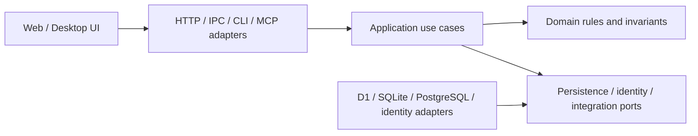

# 架構與部署設計

日期：2026-10-22。此文件保留從現有網站演進到服務、桌面與本機產品的架構分析；除明列既有能力外，均屬初期設計。

## 現有基線與可重用部分

`src/board` 是單一 Sites 系統：前端、Worker 入口、domain／application、D1 adapter 與 contracts 在同一專案建置。domain 不直接依賴 HTTP 或資料庫；application 使用 repository ports 與可信 access context，已具多種入口共用行為的基礎。分層成立不代表已經有桌面安裝程式、常駐本機服務或任意資料庫 adapter。

核心以 Workflow aggregate 管理 Task DAG、Assignment、Document 與 Decision 等語意。延伸時至少保留以下不變量與觀察差異，精確定義仍以 [collaboration/1](../../../src/Contracts/CollaborationV1/README.md) 及現行規格為準：

| 契約重點 | 演進時的要求 |
| --- | --- |
| Task DAG 與可執行條件 | 不因換 UI／語言而略過循環、依賴與狀態檢查 |
| 一個 task 的有效 assignment 與 generation fencing | 舊 Agent 不能憑過期 assignment 覆寫新工作的結果 |
| 不可變 plan／task／document revision | 接手與審閱讀取指定版本；內容雜湊綁定實際 bytes |
| expected revision／CAS | 同時寫入必須偵測衝突，交易邊界涵蓋相關狀態與結果 |
| durable accepted／rejected operation receipt | 在所屬 owner／store 與 operation 身分下保留操作結果及 payload 衝突判斷 |
| 授權先於回執重播 | 不能因曾執行過相同操作就繞過目前的存取權限 |
| unknown 恢復 | 保留原 operation ID、payload、expected revision；查詢或原請求重送，不直接換新 ID |
| 任務完成、人類接受、session 狀態 | 三者是不同事實；其中一個不自動推導另外兩個 |

目前 pause 阻止新的 claim，但不等於強制停止既有進度；cancel 使 assignment 失效，也不等於終止外部 OS 程序。真正的 scheduler、runner、process stop、lease 或資源配額需另有契約，不能由工作狀態名稱推定存在。

目前契約中的每 workflow 100 tasks／100 decisions 上限是規則上限，不是壓力測試或可承載人數。既有 snapshots／operation outcomes 也不能假定已有 TTL、刪除、ID 回收或自動壓縮；未來記憶保留政策需另定，不可反向改寫工作回執的恢復保證。

## 三種「本機」不能混用

| 現有或候選模式 | 可以支持的說法 | 不可推定 |
| --- | --- | --- |
| `src/local` Python prototype | 自有模型、SQLite、HTTP CLI、MCP stdio、合成 fixtures 及可攜匯出／還原 | 已是 collaboration/1 的離線 Board 或能直接共用資料 |
| Board UI preview／trial runtime | 本機驗證畫面或在限定生命週期使用 SQLite、loopback 與合成身分 | 已提供產品級安裝、持久身分、背景服務、維護或更新機制 |
| 未來正式本地 Board | 可規劃與同一行為契約相容的 host、store 與 UI | 現在只需包一個視窗就已完成 |

Python 原型的狀態模型、紀錄與回執語意不同；它使用自己的 planned／active／blocked／completed 流程與交易實作，不能直接替換 Board repository。特別是 accepted／rejected outcome 的持久化行為須做映射及驗證。原型能參考匯出還原設計，不能把其測試通過視為 Board provider 驗收。

## 目標依賴方向

圖中儲存 adapter 是候選集合，不是已全部實作。外部 adapter 依賴內部 port；應用案例不依賴特定資料庫、桌面外殼或 Agent SDK。前端可共用展示邏輯，但權限、版本衝突與 aggregate 不變量仍由可信後端維護。

未來 .NET 方案可讓網路服務 host 與本機 host 使用同一套 C# domain／application，輸入及持久化 adapter 因模式不同。單一核心不要求所有 bounded contexts、UI、Framework 與 runner 使用同一種語言。

## 語言與遷移

| 方案 | 可取之處 | 成本與判斷 |
| --- | --- | --- |
| 先保留 JavaScript 核心 | 近期 Sites 成果與契約可持續使用，避免因桌面構想中斷主線 | 本機 Node host、打包與安全仍要做；這不是 owner 已選定的長期後端語言 |
| C#／.NET 後端 | 符合 owner 熟悉度、review 與長期維護偏好；可評估服務／本機 hosts 共用核心 | 需重新實作及驗證行為；不能由既有 .NET 工具或架構規則代替 Board 驗收 |
| Rust 後端或桌面 shell | 符合學習興趣；Tauri shell 可獨立於主要後端語言 | 完整後端改寫的學習與維護成本需另評估；採 Tauri 不要求把所有 domain 改成 Rust |
| Go 後端 | 保留為第三順位的服務候選 | 目前沒有足夠理由優先承擔另一套語言遷移 |

跨語言可攜性由行為與訊息契約支撐，不是同一份原始碼能直接編譯。遷移需比對 canonical JSON、數值安全範圍、字串排序、UTF-8 bytes／SHA-256、時間格式、錯誤分類、版本衝突、原子性與 idempotency。現有 JavaScript／Python vectors 可當比較基準，但不能直接宣告 C# 已相容。

建議遷移方式是先固定一個公開行為切片與資料邊界，再建立替代 host／adapter，驗證一致性及退出／回復路徑；避免長期維護兩份可任意寫入的業務權威。

## UI 與桌面外殼

| 選項 | 技術組合與重用 | 適用條件／代價 |
| --- | --- | --- |
| WinUI 3＋C#，必要時 WebView2 | Windows 原生外殼或控制項，可嵌入既有 Web UI | Windows 優先時值得評估；原生 UI 重寫需額外維護；WebView2 runtime 分發與更新要選策略 |
| Tauri＋Web UI＋C# service／sidecar | Rust shell、系統 WebView；可重用 Web UI，後端經 HTTP／IPC 或受控 sidecar 連接 | macOS／Linux 有價值時可評估；多語言、IPC、子程序生命週期及各平台套件增加成本 |
| Electron＋Web UI | 可重用 Web UI，隨應用封裝 Chromium／Node | 執行環境較一致，但安裝大小、資源、runtime 更新與 renderer／IPC 權限都需管理 |
| Browser／PWA＋線上服務 | 維持現有網頁入口，先驗證協作旅程 | 不能因此取得任意本機程序控制或完整離線資料能力 |

Microsoft 擴大部分 WinUI 3 體驗不代表全面淘汰 WebView2。WinUI 是 Windows UI 技術；WebView2 是網頁內容元件，官方教學示範兩者並存。Tauri 在 Windows 使用 WebView2、macOS 使用 WKWebView、Linux 使用 WebKitGTK：共同前端不代表相同引擎，也不代表 HTML 變成各 OS 原生控制項。來源與查核日期見 [研究紀錄](research-and-discussion.md)。

UI 選型前須收斂平台順序、輸入法／縮放／可及性、檔案與外部網址處理、離線安裝、更新責任及與本機服務的認證。不能只以「原生較快」或「WebView 跨平台」替代對目標使用情境的驗證。

## 資料庫、部署與完整離線

現在 D1 隨 Sites 保留；本機 SQLite 方向已接受；自管伺服器優先評估 PostgreSQL。更換 persistence adapter 不會自動保留 CAS、交易、唯一性、receipt、migration 與備份行為。資料庫選型需要以實際工作負載和部署責任判斷，不以語言或規模想像直接定案。

桌面線上 client 的資料權威在服務端；單機離線產品的權威在本機；企業內網部署則可由內網中央服務負責。若將來要讓同一 workflow 在多個節點離線寫入，需新的同步、衝突與權威轉移設計，本次沒有預設此功能。

正式本地產品至少還需：

1. 安裝、啟動、停止、更新及崩潰恢復；清楚決定內嵌後端、sidecar 或背景服務。
2. 本機人類與 Agent 的可信身分、能力、憑證保存及撤銷；loopback 不是授權證明。
3. 穩定資料目錄、schema migration、完整備份／還原與失敗回復；SQLite WAL 模式不能隨意只複製主檔。
4. 本機 IPC／HTTP 的存取限制，外部網址與 renderer 的權限邊界。
5. 依平台驗證簽署、runtime 分發、更新與目標企業政策。

敏感環境的「離線」還要分辨：工作紀錄可離線、AI 推論可離線、工具／套件可離線，以及所有網路／遙測都被限制。若使用遠端模型，prompt 仍會送往 provider；也可以先提供沒有 AI 推論的離線紀錄功能。未來本地模型、embedding、工具、身分與更新政策是獨立評估項目。

容器可作團隊服務部署選項，不是桌面前置條件。Bind mount 與 worktree 提供檔案／checkout 邊界，不自動構成程序安全隔離。

## Agent 執行整合的額外責任

現在 Board 記錄及協調外部 Agent。若未來管理程序，需明確的執行授權：工具、工作區、網路、秘密、時間及資源範圍；另需 runner handle、啟動結果、狀態觀察與實際停止確認。

「使用者要求取消」「Board assignment 失效」「已送出停止訊號」「程序已結束」「外部副作用已完成」是不同事件。啟動成功但回寫前崩潰時要能對帳，避免重複啟動；但任意 shell、外部 API 或模型工具副作用不能概括承諾 exactly-once。停止與隔離機制需依 OS／runtime 驗證，而非以工作資料夾或 Tauri capability 宣稱安全沙箱已成立。
