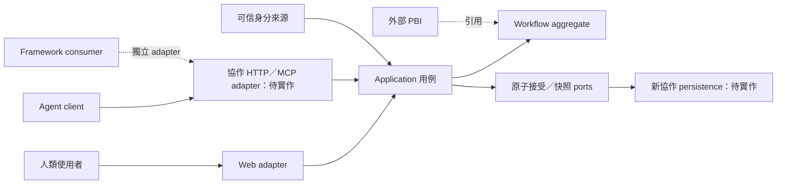

# 領域地圖與共同語言

類型：領域規格導覽。狀態：2026-10-13 正規化版；來源基線見 [索引](README.md)。主要依據為 [Issue #3 快照](sources/issue-3.json) 的 DDD 節與一至八節，以及 [ARCHITECTURE](../../ARCHITECTURE.md)。本文件整理既有選擇，不另行核准架構。

## 系統目的與語意邊界

Workflow Board 保存一次目標明確工作的計畫、任務、成果、指定決策與接手資訊。新建協作 workflow 的服務紀錄是其執行狀態權威；外部 Issue／PBI 仍由原系統管理，Agent session 是執行環境，兩者都不能替代 Workflow。

| Context | 擁有的資訊與決策 | 提供給 Board 的內容 | 邊界限制 |
| --- | --- | --- | --- |
| Workflow 協作 | Workflow、Task、Assignment、Document、Decision、必要交付、Handoff | 受授權命令與有界讀取 | 一個 Workflow 的一致性由 aggregate root 維護 |
| 外部工作管理 | Epic／Feature／Story／Task、需求內容與外部狀態 | ExternalWorkRef、觀察時間、解析結果 | 不建 PM connector、不自動關閉或雙寫 PBI |
| 身分與存取 | principal／delegation binding 驗證及撤銷 | 可信 owner、ActorRef、capabilities | Client 自填 owner／human／session 不能建立權限 |
| Agent／skill 執行 | 程序、工具呼叫、session、worktree、實際成果產生 | SessionRef／SkillRef、報告與證據 | Board 不啟動程序、不保證檔案鎖定、不因 pause 宣稱程序已停止 |
| Framework consumer | provider/store/ref、checkpoint、context／resume 能力協商 | 版本化 adapter 映射 | checkpoint 不能暗中變成 claim／complete／approval |

這些是語意責任，不要求建立五個服務。現行選擇是單一 Board package、CI 與 Worker 部署；frontend、backend、contracts 保持明確來源邊界。Local 原型是另一個獨立模型，不共用名稱相似的 aggregate。

圖中的新協作 adapters 是已定義責任、待實作路徑；既有人工 Board 的 HTTP／D1 已有自己的實作，不因圖示而被視為已接通新 profile。

## 共同語言

| 詞彙 | 精確意義 | 容易混淆但必須分開的概念 |
| --- | --- | --- |
| Workflow | 一次有目標、範圍、必要交付與歷史的執行紀錄 | PBI、Sprint、chat／session |
| Task | Workflow 內可承接及提交結果的工作定義 | 外部 Issue Task、單次工具呼叫 |
| Plan | 被指定為目前計畫的不可變 DocumentRevision 原文 | 從 Markdown checkbox 推導的執行狀態 |
| TaskDefinitionRevision | 某 Task 的內容、scope、完成條件、依賴與 basis 的版本 | Workflow 的整體 CAS revision |
| Assignment | 可信 actor 對目前 task definition 的有效承接 | owner 相同、session label 相同、猜中 assignment ID |
| Generation | 每次重新承接的世代，fence 失效承接者 | lease 到期、自動搶回、工作定義版本 |
| Ready | pending、前置完成、輸入條件滿足、無阻擋或有效承接 | 不要求 Workflow active |
| Claimable | ready 加上 Workflow active 與呼叫者有權承接 | ready 不保證有權 claim |
| Workstream | 呈現／範圍標籤 | 無獨立 lifecycle；不自動決定先後或檔案隔離 |
| Decision | 明列問題、basis、required decider、阻擋範圍的決定 | 每個 task 的固定人工批准、任意文字建議 |
| Handoff | 已完成／未完成／成果／限制／下一步等資訊 | 單独記錄不等於 release、claim 或程序啟動 |
| Resume | context 加上必要的指定版本點讀 | 不自動 claim，不擴張允許範圍 |
| Checkpoint | 已觀察進度與下一步的追加紀錄 | 不自動改 lifecycle 或人的決定 |
| Result／Evidence | 完成條件對照、實際觀察、來源、限制與產物引用 | 實際品質、部署、正式採用的推定證明 |
| Receipt | application 的一次命令持久接受／拒絕結果 | 人的核准、domain event、工作完成本身 |
| Unknown | 尚未取得可信的持久 operation 結果 | 不能當 rejected 或安全另開新操作的證明 |

## Aggregate 與一致性

Workflow 是新協作唯一 aggregate root。Task、TaskAssignment、Document 與 Decision 是其內部成員；可使用 child ref 點讀，不提供繞過 root 不變條件的獨立 child CRUD。DocumentRevision、結果、交接、證據與已發生事件是追加事實；更正保留歷史關聯。事件不被選為唯一狀態來源，也沒有跨服務事件派工的承諾。

一次接受同時約束整張 DAG、目前 assignment、工作定義及決策版本、plan 原文與必要交付。命令不得使用已截斷的 context 頁面當成完整 command state。不同 tasks 的變更仍會競爭 Workflow CAS；協調 revision 後可以分別執行，無關 task 變更不能使原有效 assignment 失效。

原子提交包括 domain state、children、文件原文、事件、accepted receipt 及 revision；確定性拒絕的 durable receipt 只記錄拒絕，不推進領域狀態。這是對 repository 的行為要求，不限定一個概念一張表，也不從 SQLite fixture 推定 D1 保證。

## 四種紀錄必須分流

| 紀錄 | 識別／權威 | 執行規則 | 相容策略 |
| --- | --- | --- | --- |
| 新協作 | `workflow-board/collaboration/1`；完整 store／personal namespace／collaboration kind／workflow ref | DAG、多 task 可並行、唯一有效 assignment、指定決策 | 新命令核心；新 queries／transport／store 待實作 |
| 人工 Board | `framework-board/1`；owner 內的 Board workflow | human execution；進行中 workflow 恰有一個 active task | 保留既有欄位、hash、receipt 與 migrations |
| Legacy | 明確 legacy 入口與既有命令／資料格式 | 保留既有 reducer 的狀態與驗證 | 不把未知 profile 當 legacy fallback |
| Source snapshot | 固定來源 catalog 及來源 revision | 唯讀，提供 workflow／document 原文與來源資訊 | 不轉成協作寫入；不自動接管 Framework Git 權威 |

Python local prototype 另有 namespace、角色、文件批准及 portable 格式；既不是上表任一 profile 的 production repository，也不是新協作離線 failover。四類 Board 紀錄與 local 間沒有隱含的資料移轉或雙寫。

## 跨 context 的最小驗收例子

- Given 同一外部 PBI 被 W1、W2 引用，When 分別取得 context，Then 保留兩個 workflow 身分及相同來源引用，不因 PBI 相同而合併。
- Given Agent 提交 task 結果，When 結果被接受，Then 保存結果／相關 revisions；外部 Issue、部署或產品採用狀態不因而改變。
- Given 有權人類暫停 workflow，When 既有 Agent 再提交有效完成，Then 依 paused 契約處理，但另一個 ready task 不可新 claim；不能把「暫停」呈現成已停止外部程序。
- Given 舊人工 workflow 已有 active task，When 以新協作 payload 向不支援的新入口提交，Then 明確拒絕，不將原資料轉為多 Agent 模型。

上述為本次整理的導覽例子；完整可自動化前提、斷言及既有 B／V 編號映射見 [正式測試規格](tests/README.md)。
